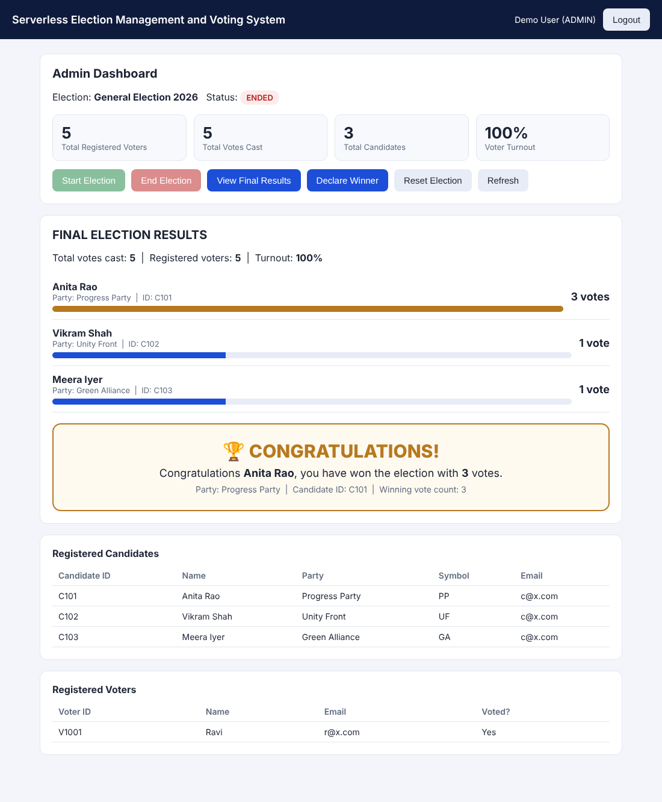

# Serverless Election Management and Voting System Using AWS

A fully serverless election management and voting system built on AWS. It uses S3, API Gateway, Lambda, DynamoDB, Cognito, IAM and CloudWatch. It has role-based access, one-vote enforcement, winner declaration and tie handling.



---

## 1. Project Overview

The system runs a complete election entirely on managed AWS services: there are no servers to provision. Voters and candidates register and log in with Amazon Cognito. An admin controls the election lifecycle: start, end, reset and declare the winner. Voters cast exactly one vote, and nobody sees live results. Final results and the winner are only revealed to the admin and candidates after the election has ended.

## 2. Problem Statement

Traditional online voting prototypes often run on always-on servers and trust the browser to enforce rules. They also show live tallies that can influence voters. A small institution needs a system that is cheap to run, scales automatically and enforces election rules on the backend. It must also keep results hidden until voting closes.

## 3. Objectives

- Build an election platform using **only serverless AWS services**.
- Provide secure **registration and login** for voters and candidates.
- Enforce **one vote per voter** on the backend, safe under concurrent requests.
- Give the **admin** full control of the election lifecycle.
- Hide live results from voters and reveal **final results** only after the election ends.
- Calculate the **winner** on the backend and detect **ties** without random selection.

## 4. Features

- Voter registration
- Candidate registration
- Admin role
- Cognito authentication
- Forgot Password flow (email verification code)
- Password reset with code confirmation and Resend Code
- First-login `NEW_PASSWORD_REQUIRED` handling
- Friendly Cognito error messages
- Role-based dashboards
- Dynamic candidate listing (from DynamoDB)
- Start election
- End election
- Reset election
- One vote per voter
- Atomic vote transaction
- No live results for voters
- Final results for admin and candidates
- Winner declaration
- Tie detection
- Turnout statistics
- CloudWatch monitoring
- Serverless deployment

## 5. AWS Services Used

| Service | Purpose |
|---|---|
| **Amazon S3** | Static website hosting for the HTML/CSS/JavaScript frontend |
| **Amazon API Gateway** | HTTP API with routes and a Cognito JWT authorizer |
| **AWS Lambda** | Six Python functions holding all business logic |
| **Amazon DynamoDB** | Users, candidates, election state and votes |
| **Amazon Cognito** | User pool for sign-in. Groups `VOTER`, `CANDIDATE`, `ADMIN` give the roles |
| **AWS IAM** | Least-privilege execution role for the Lambdas |
| **Amazon CloudWatch** | Lambda logs and monitoring |

## 6. Architecture

```
User Browser
     ↓
Amazon S3 Static Website   (index.html, styles.css, app.js, config.js)
     ↓
Amazon API Gateway         (HTTP API + Cognito JWT authorizer)
     ↓
AWS Lambda                 (6 Python functions)
     ↓
Amazon DynamoDB            (UsersTable, CandidatesTable, ElectionTable, VotesTable)

Amazon Cognito    → Authentication and Roles (VOTER / CANDIDATE / ADMIN groups)
AWS IAM           → Permissions (least-privilege Lambda execution role)
Amazon CloudWatch → Monitoring and Logs
```

See [docs/architecture.md](docs/architecture.md) for details.

## 7. User Roles

| Role | How it is assigned | Can do |
|---|---|---|
| **VOTER** | Self-registration → Cognito group `VOTER` | View candidates, cast one vote |
| **CANDIDATE** | Self-registration → Cognito group `CANDIDATE` | View own profile and election status; view final results after the election ends |
| **ADMIN** | Created by the system owner in Cognito (group `ADMIN`); **cannot self-register** | View voters and candidates, start, end and reset the election, view results, declare the winner |

## 8. Voter Flow

1. Register with Full Name, Email, Voter ID and Password.
2. Log in. The app routes to the **Voter Dashboard** ("Welcome, &lt;name&gt;").
3. See the election status and the list of registered candidates (name, party, candidate ID).
4. If the election is `ACTIVE`, select one candidate and click **Cast Vote**.
5. See **"Vote submitted successfully."** A second attempt shows **"You have already voted in this election."**
6. Voters never see vote counts, a leaderboard or the winner.

## 9. Candidate Flow

1. Register with Candidate Name, Email, Candidate ID, Party Name, Symbol and Password.
2. Log in. The app routes to the **Candidate Dashboard**: name, party, candidate ID and election status.
3. While the election is `NOT_STARTED` or `ACTIVE`, results are hidden.
4. After the admin ends the election, the dashboard shows all candidates' totals and the winner (or a tie).

## 10. Admin Flow

1. Log in with the admin account. The app routes to the **Admin Dashboard**.
2. See total registered voters, total votes cast, total candidates and turnout percentage.
3. See the lists of registered candidates and voters, including whether each voter has voted.
4. **Start Election**, then **End Election**.
5. **View Final Results** and **Declare Winner**.
6. **Reset Election** clears all votes so a new election can start. Registered users are kept.

## 11. Election Lifecycle

```
NOT_STARTED ──Start──▶ ACTIVE ──End──▶ ENDED
     ▲                                   │
     └──────────────Reset────────────────┘
```

| Status | Voting | Results |
|---|---|---|
| `NOT_STARTED` | Blocked: "Election has not started yet." | Hidden |
| `ACTIVE` | Allowed (once per voter) | Hidden from everyone |
| `ENDED` | Blocked: "Election has ended." | Visible to admin and candidates only |

Only these transitions are accepted by the backend. For example, `NOT_STARTED → ENDED` is rejected.

## 12. Winner Logic

`GetResultsFunction` reads every candidate's vote count from `CandidatesTable` and sorts them in descending order. If exactly one candidate has the highest count, that candidate is the winner:

> 🏆 CONGRATULATIONS! Congratulations &lt;Candidate&gt;, you have won the election with &lt;N&gt; votes.

The response includes the winner's party, candidate ID and winning vote count. When the admin clicks **Declare Winner**, the result summary is stored in `ElectionTable`.

## 13. Tie Handling

If two or more candidates share the highest vote count, the backend returns `isTie: true` with the list of tied candidates. **No winner is chosen at random.** The UI shows:

> **Election Result: Tie** — The election resulted in a tie between Candidate A and Candidate B.

## 14. One-Vote-Per-Voter Protection

`CastVoteFunction` first validates the request:

1. The JWT is verified.
2. The role is `VOTER`.
3. The election is `ACTIVE`.
4. The voter exists.
5. `hasVoted` is false.
6. The candidate exists.

It then performs **one DynamoDB `TransactWriteItems`** call, which applies all of its steps or none:

| Step | Table | Condition |
|---|---|---|
| ConditionCheck | ElectionTable | `status = ACTIVE` |
| Put vote | VotesTable | `attribute_not_exists(voteId)`. The `voteId` is `<electionId>#<userId>`, so it is unique per voter. |
| `ADD votes 1` | CandidatesTable | `attribute_exists(candidateId)` (atomic counter) |
| Set `hasVoted = true` | UsersTable | only if it was false |

Because the vote ID is deterministic and every step is conditional, two simultaneous requests from the same voter can never both succeed. The check never relies on the frontend.

## 15. Authentication and Authorization

- The frontend logs in with Cognito `InitiateAuth` (`USER_PASSWORD_AUTH`) and receives an **ID token**.
- Every protected request sends `Authorization: Bearer <ID token>`.
- The API Gateway **JWT authorizer** validates the token's signature, issuer (the user pool) and audience (the app client). Invalid or missing tokens get `401 Unauthorized` before any Lambda runs.
- Each Lambda reads the role from the verified `cognito:groups` claim and re-checks it.
- Registration (`POST /register`) is the only public API route. It only accepts `VOTER` or `CANDIDATE`. The Lambda creates the Cognito user and adds it to the matching group.

### Password reset and account recovery

All password flows talk directly to the Cognito User Pool API from the browser (no extra Lambda and no secrets):

| Flow | Cognito action(s) | What the user sees |
|---|---|---|
| **Forgot Password** | `ForgotPassword` | Enters their email on the *Forgot Password* screen; Cognito emails a verification code. |
| **Verification code + new password** | `ConfirmForgotPassword` | *Reset Password* screen: verification code, new password and confirmation. **Resend Code** calls `ForgotPassword` again. |
| **Admin-forced reset** | `InitiateAuth` → `PasswordResetRequiredException` → `ForgotPassword` | If an admin resets a user's password in Cognito, the login screen automatically sends a code and opens the reset screen. |
| **Temporary password (first login)** | `InitiateAuth` → `NEW_PASSWORD_REQUIRED` → `RespondToAuthChallenge` | *Set a New Password* screen, then the user is logged in and routed to their dashboard. |

Cognito errors (`CodeMismatchException`, `ExpiredCodeException`, `InvalidPasswordException`, `LimitExceededException`, `NotAuthorizedException`, `UserNotFoundException`, ...) are mapped to friendly messages. The new password is checked in the browser (8+ characters, upper case, lower case, number, symbol) and again by the Cognito password policy. Verification codes and passwords are never logged or stored by the application.

## 16. DynamoDB Tables

| Table | Partition key | Important attributes |
|---|---|---|
| **UsersTable** | `userId` (S): the Cognito `sub` | `name`, `email`, `role`, `voterId` or `candidateId`, `partyName`, `symbol`, `hasVoted` |
| **CandidatesTable** | `candidateId` (S) | `candidateName`, `partyName`, `symbol`, `email`, `userId`, `votes` (number) |
| **ElectionTable** | `electionId` (S): `MAIN` | `electionName`, `status` (`NOT_STARTED` / `ACTIVE` / `ENDED`), `resultDeclared`, `declaredResult` |
| **VotesTable** | `voteId` (S): `MAIN#<userId>` | `voterId`, `userId`, `candidateId`, `electionId`, `timestamp` |

## 17. Lambda Functions

All functions use the Python runtime. Each deployment package contains `lambda_function.py` plus the shared `common.py`.

### RegisterUserFunction — `lambda/register_user/`
- **Purpose:** Register a voter or candidate.
- **Input:** JSON body with `role` (`VOTER`/`CANDIDATE`), `name`, `email`, `password`. Voters also send `voterId`. Candidates also send `candidateId`, `partyName` and `symbol`.
- **Output:** `201 {"message": "... registered successfully. Please login."}`, or `400`/`409` with a reason.
- **AWS services:** Cognito (AdminCreateUser, AdminSetUserPassword, CreateGroup, AdminAddUserToGroup, AdminDeleteUser for rollback), DynamoDB (UsersTable, CandidatesTable).

### GetCandidatesFunction — `lambda/get_candidates/`
- **Purpose:** Return the election status, the caller's own profile and the candidate list. It never returns vote counts.
- **Input:** JWT claims (any role).
- **Output:** `{election:{electionName,status}, me:{name,role,hasVoted|candidateId...}, candidates:[...]}`
- **AWS services:** DynamoDB (UsersTable, CandidatesTable, ElectionTable).

### CastVoteFunction — `lambda/cast_vote/`
- **Purpose:** Record one vote per voter atomically.
- **Input:** JWT claims (VOTER) and the body `{"candidateId": "..."}`.
- **Output:** `{"message": "Vote submitted successfully"}`, or `{"message": "You have already voted in this election"}`, or a status or validation error.
- **AWS services:** DynamoDB TransactWriteItems (ElectionTable, VotesTable, CandidatesTable, UsersTable).

### GetAdminDashboardFunction — `lambda/admin_dashboard/`
- **Purpose:** Admin overview.
- **Input:** JWT claims (ADMIN).
- **Output:** Election status, stats (`totalVoters`, `totalCandidates`, `totalVotes`, `turnoutPercent`), voters and candidates lists. Results are added only when the election is `ENDED`.
- **AWS services:** DynamoDB (all four tables).

### UpdateElectionStatusFunction — `lambda/election_status/`
- **Purpose:** Start, end or reset the election.
- **Input:** JWT claims (ADMIN) and the body `{"status": "ACTIVE" | "ENDED" | "RESET"}`.
- **Output:** `{"message": "Election started.", "status": "ACTIVE"}` and similar. Invalid transitions return `400`.
- **AWS services:** DynamoDB (ElectionTable conditional update; RESET also clears VotesTable, zeroes candidate votes and sets every voter's `hasVoted` to false).

### GetResultsFunction — `lambda/get_results/`
- **Purpose:** Final results, winner and tie detection, and winner declaration.
- **Input:** JWT claims (ADMIN or CANDIDATE for `GET`, ADMIN only for `POST /results/declare`).
- **Output:** `{totalVotes, totalVoters, turnoutPercent, results[], winner, isTie, tiedCandidates[], resultDeclared}`. Returns `403` unless the status is `ENDED`.
- **AWS services:** DynamoDB (CandidatesTable, UsersTable, ElectionTable).

## 18. API Gateway Routes

HTTP API `VotingAPI`, `$default` stage with auto-deploy. The full definition is in [api/api-definition.json](api/api-definition.json).

| Method | Route | Auth | Lambda | Allowed roles |
|---|---|---|---|---|
| POST | `/register` | Public | RegisterUserFunction | anyone (creates VOTER/CANDIDATE only) |
| GET | `/candidates` | Cognito JWT | GetCandidatesFunction | VOTER, CANDIDATE, ADMIN |
| POST | `/vote` | Cognito JWT | CastVoteFunction | VOTER |
| GET | `/admin/dashboard` | Cognito JWT | GetAdminDashboardFunction | ADMIN |
| POST | `/admin/election` | Cognito JWT | UpdateElectionStatusFunction | ADMIN |
| GET | `/results` | Cognito JWT | GetResultsFunction | ADMIN, CANDIDATE (after ENDED) |
| POST | `/results/declare` | Cognito JWT | GetResultsFunction | ADMIN |

CORS is configured on the API with the website origin(s) only (the S3 HTTPS object URL and the S3 website endpoint), headers `authorization, content-type` and methods `GET, POST, OPTIONS`. Protected routes also require a valid Cognito JWT, so CORS is not the only protection.

## 19. Frontend

Plain **HTML, CSS and JavaScript**, with no frameworks. It is a single page with sections for Login, Voter Registration, Candidate Registration, the Voter, Candidate and Admin dashboards, and Final Results.

| File | Purpose |
|---|---|
| `frontend/index.html` | Page layout for all views |
| `frontend/styles.css` | Styling |
| `frontend/app.js` | Cognito login, Forgot Password / reset / new-password flows, API calls, role-based routing and dashboards |
| `frontend/config.js` | Public deployment identifiers: region, API URL, user pool ID, app client ID |
| `frontend/config.example.js` | Placeholder template for your own deployment |

`config.js` holds only **public identifiers** that every Cognito single-page app exposes to the browser. It contains no secrets and the app client has no client secret.

## 20. Deployment

1. **DynamoDB:** create `UsersTable` (`userId`), `CandidatesTable` (`candidateId`), `ElectionTable` (`electionId`) and `VotesTable` (`voteId`). All partition keys are strings and use on-demand capacity.
2. **Cognito:** create a user pool that signs in with email, plus an app client **without a client secret** and with `ALLOW_USER_PASSWORD_AUTH` enabled. Create the group `ADMIN`, then create the admin user and add it to `ADMIN`. The `VOTER` and `CANDIDATE` groups are created automatically on first registration. Account recovery by email must be enabled so **Forgot Password** can send verification codes (the default Cognito email sender is fine for a demo; it has a small daily sending limit).
3. **IAM:** create a Lambda execution role with `AWSLambdaBasicExecutionRole` plus:
   - `dynamodb:GetItem/PutItem/UpdateItem/DeleteItem/Scan/Query/BatchWriteItem/ConditionCheckItem` on the four tables
   - `cognito-idp:AdminCreateUser/AdminSetUserPassword/AdminAddUserToGroup/AdminDeleteUser/CreateGroup` on the user pool
4. **Lambda:** run `scripts/package_lambdas.sh`, then create the six functions from `build/*.zip`. Use the Python runtime and the handler `lambda_function.lambda_handler`. Set the environment variable `USER_POOL_ID` (the other settings have sensible defaults in `lambda/shared/common.py`). Use a 15-second timeout for RegisterUserFunction.
5. **API Gateway:** import `api/api-definition.json` as an HTTP API after replacing `YOUR_ACCOUNT_ID`, `YOUR_COGNITO_USER_POOL_ID` and `YOUR_COGNITO_CLIENT_ID`. Grant API Gateway permission to invoke each Lambda, and use the `$default` stage with auto-deploy.
6. **S3:** copy `frontend/config.example.js` to `config.js` and fill in your values. Enable static website hosting, then upload the four frontend files with the correct `Content-Type` (`text/html`, `text/css`, `application/javascript`). Add a bucket policy allowing `s3:GetObject` on those files only.

## 21. Testing

`tests/test_election_flow.py` runs every Lambda against mocked DynamoDB and Cognito ([moto](https://github.com/getmoto/moto)). It covers:

- registration of 3 candidates and 5 voters, duplicate IDs and emails, and blocked admin self-registration
- role enforcement (voter or candidate calling admin routes, admin or candidate voting)
- status transitions and invalid transitions
- voting, duplicate vote, invalid candidate, voting before start and after end
- hidden results during `ACTIVE`, turnout statistics, winner calculation and declaration
- reset election and **tie detection**

```bash
pip install -r tests/requirements.txt
python tests/test_election_flow.py
```

The live deployment was also verified in AWS (ap-south-1):

- every protected route returns `401` without a token or with an invalid token; `POST /register` refuses `role: ADMIN`
- with Lambda console test events using real users from DynamoDB: vote succeeds, repeat vote → `409 You have already voted in this election`, invalid candidate → `400`, admin vote → `403`, voter/candidate results while `ACTIVE` → `403`, voter election control → `403 Admin access only`
- end → declare winner (correct winner, total votes and turnout), candidate final results after `ENDED`, reset, 1–1 **tie** detection, and a final reset back to a clean `NOT_STARTED` state
- CloudWatch logs show each recorded vote

## 22. Security

- **Roles come from verified Cognito claims.** API Gateway validates the JWT, and the Lambdas read `cognito:groups` from the verified claims.
- **The browser cannot decide** whether someone is a VOTER, CANDIDATE or ADMIN. The role shown in the UI only chooses which dashboard to render, and every API call is re-checked on the backend.
- **Voters cannot access admin routes.** Those return `403 Admin access only`.
- **Candidates cannot manage elections or vote.**
- **Protected APIs reject unauthenticated users** with `401 Unauthorized` at API Gateway.
- **Duplicate voting is prevented on the backend** with a conditional DynamoDB transaction.
- **Voters never receive vote counts** from any API, and results are gated on `status = ENDED`.
- The Lambda execution role is **least-privilege**, limited to the four tables and the one user pool.
- The S3 bucket policy exposes **only the four website files**.
- **No secrets are stored in this repository:** no AWS keys, passwords, tokens or client secrets. Account-specific IDs in the API definition are placeholders.

## 23. Project Demo Flow

See [docs/demo-flow.md](docs/demo-flow.md) for the step-by-step professor demo.

## 24. Future Enhancements

- Multiple concurrent elections (an `electionId` chosen by the admin)
- Email verification at registration time
- Scheduled start and end with Amazon EventBridge
- CloudFront + HTTPS in front of the S3 website
- Infrastructure as Code (AWS SAM / CloudFormation / CDK)
- An audit report export of anonymised votes
- Admin approval of candidate registrations

## 25. Cleanup

To avoid charges, delete these resources when you are finished:

- the S3 website bucket objects and bucket
- the API Gateway HTTP API
- the six Lambda functions and their CloudWatch log groups
- the four DynamoDB tables
- the Cognito user pool
- the IAM execution role and its policy

## 26. Author

**Aashritha Reddy**
Email: aashrithareddymaddur19@gmail.com

---

Licensed under the [MIT License](LICENSE).
