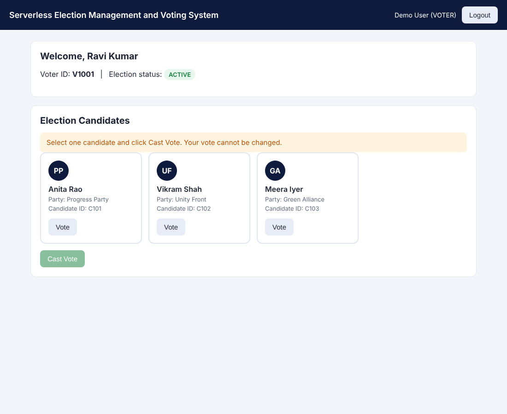
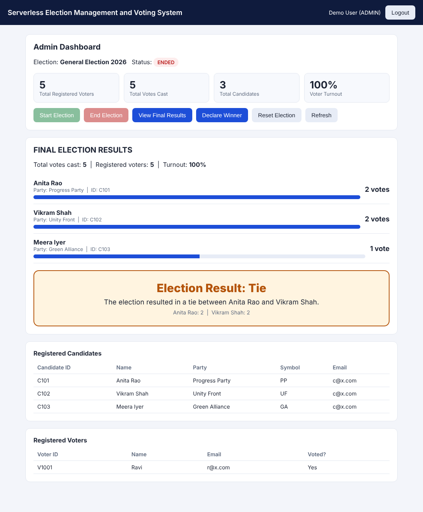
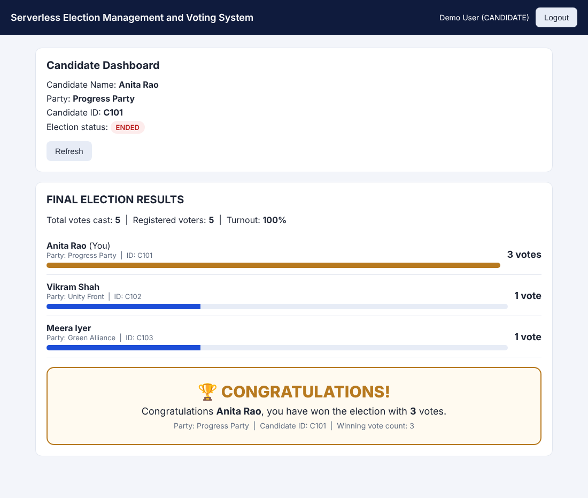

# Demo Flow

Start the demo from a clean state: election `NOT_STARTED`, every candidate on 0 votes and every voter with `hasVoted = false`. The admin's **Reset Election** button returns the system to this state.

## Part 1: Application

1. Open the S3 website and show the **Voter Registration** and **Candidate Registration** forms.
2. Register (or show already registered) 3 candidates and 5 voters.
3. **Log in as admin.** Show the registered candidates and voters and the stats (0 votes, 0% turnout).
4. Click **Start Election**. The status becomes `ACTIVE`.
5. **Log in as voter 1.** Show the candidate cards, which come from DynamoDB.
6. Select a candidate and click **Cast Vote**. The page shows **"Vote submitted successfully."**
7. Point out that the voter page has **no results, counts, winner or admin actions**.
8. Try to vote again. The page shows **"You have already voted in this election."**
9. Log in as the other voters and cast more votes.
10. **Log in as a candidate** while the election is ACTIVE. The page shows "Results will be available after the election has ended."
11. **Log in as admin** and click **End Election**.
12. Click **View Final Results**. Show every candidate's total, the turnout and the stats.
13. Click **Declare Winner**. The page shows **"🏆 CONGRATULATIONS! Congratulations &lt;Winner&gt;, you have won the election with &lt;N&gt; votes."**
14. **Log in as a candidate.** The final results and the winner are now visible.

### Optional: account recovery

- On the login screen click **Forgot Password?**, enter a registered email and click **Send Verification Code**.
- Enter the emailed code and a new password on the **Reset Password** screen (use **Resend Code** if needed), then log in with the new password.
- Accounts created with a temporary password are taken to **Set a New Password** on first login (`NEW_PASSWORD_REQUIRED`).

## Part 2: Tie handling (optional)

15. As admin, click **Reset Election**, then **Start Election**.
16. Two voters vote for two different candidates.
17. Click **End Election**, then **View Final Results**. The page shows **"Election Result: Tie"** with no random winner.

## Part 3: AWS console

18. **DynamoDB:** show the items in `UsersTable` (hasVoted), `CandidatesTable` (votes), `ElectionTable` (status) and `VotesTable`.
19. **Lambda:** show the six functions and the `CastVoteFunction` transaction code.
20. **API Gateway:** show the `VotingAPI` routes and the JWT authorizer.
21. **Cognito:** show the user pool users and the `VOTER` / `CANDIDATE` / `ADMIN` groups.
22. **CloudWatch:** show the log groups `/aws/lambda/<FunctionName>`, for example "Vote recorded" and "Election status ACTIVE -> ENDED".

## Finish

23. As admin, click **Reset Election** to leave the system clean for the next demo.

## Screenshots

| Voter dashboard | Admin results | Tie result | Candidate view |
|---|---|---|---|
|  |  |  |  |

The screenshots were rendered from the real frontend with sample data.
